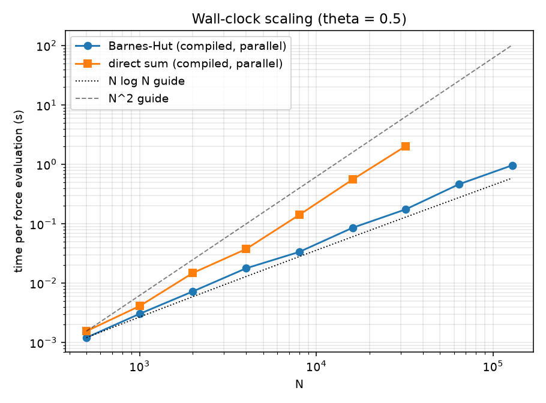

# N-Body Gravity Simulator

[](https://github.com/dmatharv25-cmd/nbody-sim/actions/workflows/tests.yml)

A from-scratch gravitational N-body simulator in Python, built to answer one question honestly:
**how accurate and how fast are the standard numerical methods, and what does each approximation cost?**
Everything is validated against analytical results and measured, not assumed.

<p align="center">
  
  
</p>

## Key findings
- **Integrators** (Euler, Velocity Verlet, RK4, all written from scratch) reproduce their theoretical orders of
  accuracy on a Kepler orbit: measured slopes of about 0.8 (Euler, pre-asymptotic at the step sizes tested), 2.00 (Verlet)
  and 4.1 (RK4).
- **Verlet's energy error stays bounded** over 20 eccentric orbits, while Euler's grows to about 100%.
- **Numba kernels** are 6-10x (serial) and 10-33x (parallel, 12 logical cores) faster than vectorized NumPy at
  N = 200-1600, agreeing to roundoff.
- **Barnes-Hut tree code** (theta = 0.5) reaches about 0.35% median force error using 29% of the direct-sum
  interactions at N = 1000.
- **Compiled Barnes-Hut** (flat-array Numba, parallel force pass) is about 900-1000x faster than the pure-Python
  tree at N = 1,000-2,000 and 11.6x faster than parallel direct summation at N = 32,000. Fitted wall-time
  exponent for N >= 4,000 is 1.18 (tree) vs 1.92 (direct sum), consistent with N log N.
- **The approximation has a physical cost:** on a Plummer star cluster, direct summation conserves momentum to
  machine precision (2e-17) while Barnes-Hut does not (1.5e-4), and Barnes-Hut energy error is 37-127x larger.

## Project structure
```
nbody/                  the library
  integrators.py        Euler, Velocity Verlet, RK4
  forces.py             vectorized NumPy direct sum
  forces_naive.py       plain-loop reference implementation
  forces_numba.py       Numba direct sum (serial and parallel)
  barnes_hut.py         pure-Python Barnes-Hut tree
  barnes_hut_numba.py   compiled flat-array Barnes-Hut tree (3D only)
  simulation.py         time-stepping driver
  initial_conditions.py initial conditions for the test systems
  diagnostics.py        energy, momentum and other conserved quantities
tests/                  pytest suite
experiments/            scripts that produce the validation figures and animations
benchmarks/             timing scripts for the force kernels and the tree
results/                generated figures and GIFs used in this README
```

## Run it
From the repository root:

```
python -m venv venv
venv\Scripts\activate           # Windows; on Linux/macOS: source venv/bin/activate
pip install -r requirements.txt
python -m pytest -q             # the first run is slow because Numba compiles the kernels
```

Reproduce the results. Scripts that make figures or animations write them to `results/`; the force-kernel benchmarks only print their tables. Run everything from the repository root:

| Section | Command |
|---|---|
| 1. Integrator convergence | `python experiments/convergence.py` |
| 1. Energy comparison | `python experiments/energy_comparison.py` |
| 2. Force-kernel timings | `python benchmarks/bench_forces.py`, `python benchmarks/bench_numba.py` |
| 3. Barnes-Hut accuracy | `python benchmarks/bench_barnes_hut.py` |
| 3. Compiled-tree scaling | `python benchmarks/bench_tree_scaling.py` (optionally with a maximum N, e.g. `16000`, for a quicker run) |
| 4. Cluster conservation | `python experiments/cluster_comparison.py` (a few minutes, because it uses the pure-Python tree) |
| Animations | `python experiments/make_animations.py` |

Timings depend on your CPU. The numbers in this README came from a 12-logical-core machine.

## 1. Integrator validation (two-body Kepler orbit, e = 0.6)
Validated against the analytical period, energy E = -G m1 m2 / (2a), and return to the initial state after one
period. Also checked on the published Chenciner-Montgomery figure-eight three-body orbit.

| Method | Measured order | Rel. energy error after 20 orbits (200 steps/orbit) |
|---|---|---|
| Euler | about 0.8 (approaches 1 as dt shrinks) | about 1.09 (energy not conserved) |
| Velocity Verlet | 2.00 | about 7e-3 (bounded, does not grow) |
| RK4 | about 4.1 | about 1e-4 (slow secular drift) |


Verlet is symplectic, so its energy error stays bounded over long runs. RK4 is far more accurate per step but
drifts slowly. Euler is unusable for orbits. Euler's measured order is below 1 because the step sizes tested are
too coarse to be in the asymptotic regime.

## 2. Force-calculation performance (3D, 12 logical cores)
All implementations agree to floating-point roundoff (max difference about 1e-13).

| N | NumPy (s) | Numba serial (s) | Numba parallel (s) | Serial speedup | Parallel speedup |
|---|---|---|---|---|---|
| 200 | 0.00549 | 0.00097 | 0.00053 | 5.7x | 10.4x |
| 400 | 0.02620 | 0.00335 | 0.00108 | 7.8x | 24.2x |
| 800 | 0.06882 | 0.00744 | 0.00243 | 9.2x | 28.3x |
| 1600 | 0.29793 | 0.02975 | 0.00906 | 10.0x | 32.9x |
| 3200 | - | 0.11988 | 0.03581 | - | - |

Speedups are relative to the vectorized NumPy version. Parallel scaling is about 3.3x over serial, not 12x,
limited by physical core count, thread overhead and memory bandwidth. All versions are still O(N^2).

## 3. Barnes-Hut tree code
Replaces distant groups of particles by their centre of mass when (node width) / (distance) < theta. With
theta = 0 it reproduces the direct sum to roundoff (tested in 2D and 3D).

| theta | median error | worst-particle error | interactions vs. direct |
|---|---|---|---|
| 0.2 | 2.4e-4 | 1.7e-3 | 75.7% |
| 0.3 | 8.7e-4 | 7.0e-3 | 54.7% |
| 0.5 | 3.5e-3 | 4.3e-2 | 29.2% |
| 0.7 | 8.6e-3 | 1.5e-1 | 17.3% |
| 1.0 | 2.4e-2 | 2.7e-1 | 9.7% |

Pair interactions grow with an empirical exponent of 1.54 over N = 250 to 2000 (direct sum: 2.00). At N = 2000 the
tree does 20% of the direct-sum work. That range is too small to confirm the asymptotic O(N log N) behaviour; see the compiled-tree measurements below.


### Compiled tree: wall-clock scaling at larger N
The tree was rewritten with flat arrays (no Python objects) and compiled with Numba; force evaluation is parallel
over particles. It matches the pure-Python tree in both forces and interaction counts (tested), and at theta = 0
it matches direct summation. Setup: 3D Gaussian cloud, theta = 0.5, one seed, best of 2-3 runs, 12 logical cores.

| N | direct sum, parallel (s) | tree, parallel (s) | tree speedup |
|---|---|---|---|
| 500 | 0.0016 | 0.0012 | 1.3x |
| 1,000 | 0.0041 | 0.0031 | 1.4x |
| 2,000 | 0.0149 | 0.0073 | 2.0x |
| 4,000 | 0.0376 | 0.0178 | 2.1x |
| 8,000 | 0.1414 | 0.0336 | 4.2x |
| 16,000 | 0.5552 | 0.0856 | 6.5x |
| 32,000 | 2.0326 | 0.1751 | 11.6x |
| 64,000 | not timed | 0.4633 | - |
| 128,000 | not timed | 0.9643 | - |

Fitted wall-time exponent for N >= 4,000: **1.18** for the tree (interaction count: 1.22) vs **1.92** for direct
summation. This is consistent with N log N but does not prove it: one distribution, one seed, a limited range.
Time divided by N log2 N rises from about 270 ns (N = 500) to about 445 ns (N = 128,000); a plausible cause is cache
effects, but this was not profiled. The compiled tree is about 860-1000x faster than the pure-Python tree at
N = 1,000-2,000. Accuracy at N = 2,000, theta = 0.5: 0.32% median force error with 20.1% of direct-sum interactions.



The dotted and dashed guide lines are anchored at the first data point, so they show slope only, not absolute time.

## 4. Does the approximation preserve the physics? (Plummer cluster)
Same cluster (N = 200, 3D Plummer sphere in virial equilibrium, softening 0.05, Velocity Verlet, dt = 0.01,
300 steps), three force models. Energy is always measured with the exact direct-sum potential.

| Force model | Wall time | Max abs(dE/E) | Max total momentum |
|---|---|---|---|
| Direct sum (NumPy) | 1.4 s | 7.4e-6 | 2.3e-17 |
| Barnes-Hut, theta = 0.5 | 107 s | 2.7e-4 | 1.5e-4 |
| Barnes-Hut, theta = 1.0 | 62 s | 9.4e-4 | 1.9e-3 |


Direct summation conserves momentum to machine precision. Barnes-Hut does not, which is consistent with tree
forces not being exactly equal and opposite between particle pairs (Newton's third law). The Barnes-Hut wall times in this table are from the original pure-Python tree.

## Limitations
- The compiled-tree scaling covers one distribution (Gaussian cloud), one seed and theta = 0.5. The fitted exponent
  of 1.18 is consistent with N log N but does not prove it, and time per N log2 N drifts upward at large N
  (cause not profiled).
- Direct summation was not timed above N = 32,000, so the tree's speedup at N = 64,000 and 128,000 is not measured.
- The compiled tree is 3D only. The cluster conservation test in section 4 used the pure-Python tree and has not
  been repeated with the compiled one.
- The cluster comparison covers one cluster, one random seed, and a short run (t = 3).
- Fixed time steps only; no adaptive stepping or collision handling beyond softening.

## Roadmap
- [x] Compile the tree with Numba and re-measure wall-clock scaling at larger N
- [ ] Adaptive time stepping
- [ ] Sun-Earth-Moon validation against NASA JPL ephemeris data
- [ ] Interactive Streamlit UI / animations


