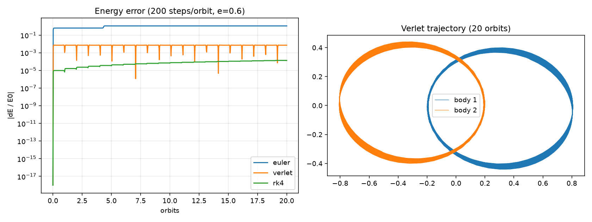
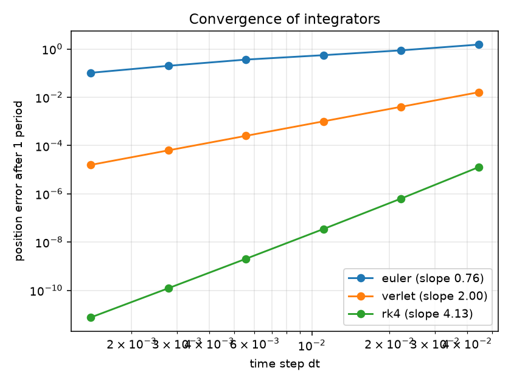

# N-Body Simulator with Validated Numerical Integrators

A from-scratch gravitational N-body simulator in Python/NumPy. The focus is **numerical correctness**:
every integrator is validated against analytical results (Kepler orbits, conservation laws,
published periodic solutions) and its order of accuracy is measured empirically.

## What's implemented
- Vectorized O(N^2) Newtonian gravity (optional softening)
- Integrators written from scratch: **Euler**, **Velocity Verlet** (symplectic), **RK4**
- Diagnostics: total energy, linear and angular momentum
- Initial conditions with known answers: Keplerian two-body orbit, Chenciner-Montgomery figure-eight
- 12 pytest tests covering both the physics and the numerics

## Results
| Method | Order (measured) | Rel. energy error after 20 orbits (200 steps/orbit, e=0.6) |
|---|---|---|
| Euler | ~0.8 (approaches 1 as dt shrinks) | ~1.09 (energy not conserved) |
| Velocity Verlet | 2.00 | ~7e-3 (bounded, does not grow) |
| RK4 | ~4.1 | ~1e-4 (slow secular drift) |

**Takeaways:** Verlet is symplectic, so its energy error stays bounded over long runs. RK4 is far more
accurate per step but drifts slowly over very long runs. Euler is unusable for orbits.
Euler's measured order is below 1 because the tested step sizes are too coarse to be in the asymptotic regime.

## Run it

    pip install -r requirements.txt
    pytest -q
    python experiments/energy_comparison.py
    python experiments/convergence.py

## Roadmap
- [ ] Numba acceleration and benchmarks vs. pure NumPy
- [ ] Barnes-Hut tree (O(N log N)) with accuracy-vs-speed tradeoff
- [ ] Adaptive time stepping
- [ ] Sun-Earth-Moon validation against NASA JPL ephemeris data
- [ ] Streamlit UI / animations
