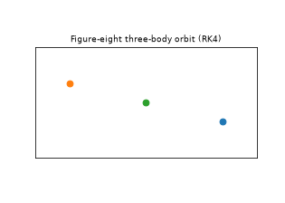
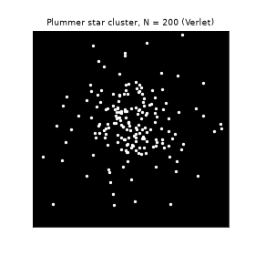
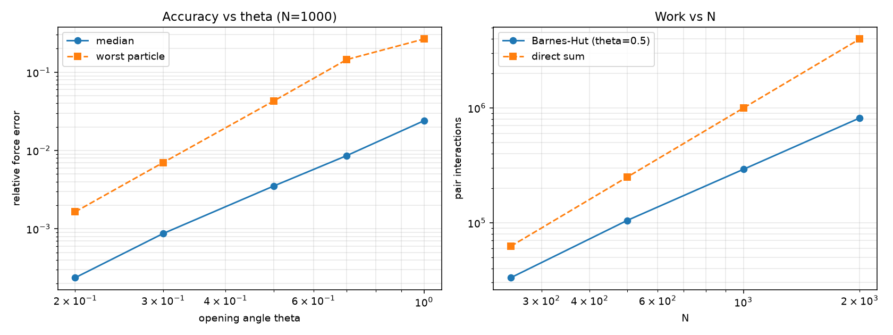
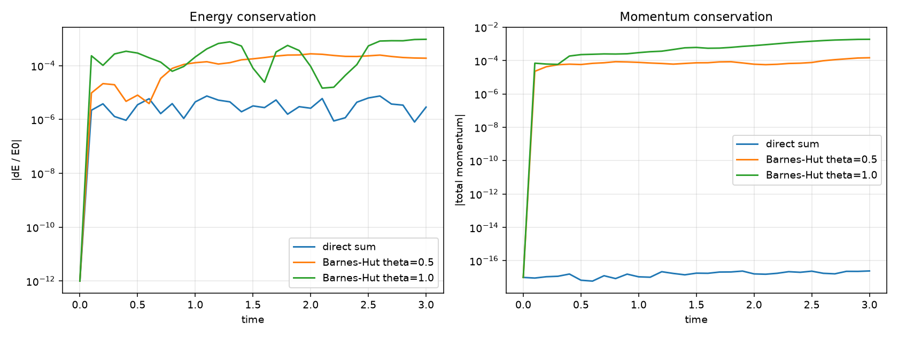

# N-Body Gravity Simulator

A from-scratch gravitational N-body simulator in Python, built to answer one question honestly:
**how accurate and how fast are the standard numerical methods, and what does each approximation cost?**
Everything is validated against analytical results and measured, not assumed.

  
  

## Key findings
- **Integrators** (Euler, Velocity Verlet, RK4, all written from scratch) reproduce their theoretical orders of
  accuracy on a Kepler orbit: measured slopes of about 1 (Euler, pre-asymptotic at the step sizes tested), 2.00 (Verlet)
  and 4.1 (RK4).
- **Verlet's energy error stays bounded** over 20 eccentric orbits, while Euler's grows to about 100%.
- **Numba kernels** are 6-10x (serial) and 10-33x (parallel, 12 logical cores) faster than vectorized NumPy at
  N = 200-1600, agreeing to roundoff.
- **Barnes-Hut tree code** (theta = 0.5) reaches about 0.35% median force error using 29% of the direct-sum
  interactions at N = 1000.
- **The approximation has a physical cost:** on a Plummer star cluster, direct summation conserves momentum to
  machine precision (2e-17) while Barnes-Hut does not (1.5e-4), and Barnes-Hut energy error is 37-127x larger.

## Project structure

## Run it

## 1. Integrator validation (two-body Kepler orbit, e = 0.6)
Validated against the analytical period, energy E = -G m1 m2 / (2a), and return to the initial state after one
period. Also checked on the published Chenciner-Montgomery figure-eight three-body orbit.

| Method | Measured order | Rel. energy error after 20 orbits (200 steps/orbit) |
|---|---|---|
| Euler | about 0.8 (approaches 1 as dt shrinks) | about 1.09 (energy not conserved) |
| Velocity Verlet | 2.00 | about 7e-3 (bounded, does not grow) |
| RK4 | about 4.1 | about 1e-4 (slow secular drift) |

Verlet is symplectic, so its energy error stays bounded over long runs. RK4 is far more accurate per step but
drifts slowly. Euler is unusable for orbits. Euler's measured order is below 1 because the step sizes tested are
too coarse to be in the asymptotic regime.

## 2. Force-calculation performance (3D, 12 logical cores)
All implementations agree to floating-point roundoff (max difference about 1e-13).

| N | NumPy (s) | Numba serial (s) | Numba parallel (s) | Serial speedup | Parallel speedup |
|---|---|---|---|---|---|
| 200 | 0.00549 | 0.00097 | 0.00053 | 5.7x | 10.4x |
| 400 | 0.02620 | 0.00335 | 0.00108 | 7.8x | 24.2x |
| 800 | 0.06882 | 0.00744 | 0.00243 | 9.2x | 28.3x |
| 1600 | 0.29793 | 0.02975 | 0.00906 | 10.0x | 32.9x |
| 3200 | - | 0.11988 | 0.03581 | - | - |

Speedups are relative to the vectorized NumPy version. Parallel scaling is about 3.3x over serial, not 12x,
limited by physical core count, thread overhead and memory bandwidth. All versions are still O(N^2).

## 3. Barnes-Hut tree code
Replaces distant groups of particles by their centre of mass when (node width) / (distance) < theta. With
theta = 0 it reproduces the direct sum to roundoff (tested in 2D and 3D).

| theta | median error | worst-particle error | interactions vs. direct |
|---|---|---|---|
| 0.2 | 2.4e-4 | 1.7e-3 | 75.7% |
| 0.3 | 8.7e-4 | 7.0e-3 | 54.7% |
| 0.5 | 3.5e-3 | 4.3e-2 | 29.2% |
| 0.7 | 8.6e-3 | 1.5e-1 | 17.3% |
| 1.0 | 2.4e-2 | 2.7e-1 | 9.7% |

Pair interactions grow with an empirical exponent of 1.54 over N = 250 to 2000 (direct sum: 2.00). At N = 2000 the
tree does 20% of the direct-sum work. That range is too small to confirm the asymptotic O(N log N) behaviour.

## 4. Does the approximation preserve the physics? (Plummer cluster)
Same cluster (N = 200, 3D Plummer sphere in virial equilibrium, softening 0.05, Velocity Verlet, dt = 0.01,
300 steps), three force models. Energy is always measured with the exact direct-sum potential.

| Force model | Wall time | Max abs(dE/E) | Max total momentum |
|---|---|---|---|
| Direct sum (NumPy) | 1.4 s | 7.4e-6 | 2.3e-17 |
| Barnes-Hut, theta = 0.5 | 107 s | 2.7e-4 | 1.5e-4 |
| Barnes-Hut, theta = 1.0 | 62 s | 9.4e-4 | 1.9e-3 |

Direct summation conserves momentum to machine precision. Barnes-Hut does not, which is consistent with tree
forces not being exactly equal and opposite between particle pairs (Newton's third law).

## Limitations
- The Barnes-Hut tree is pure Python: at N = 200 it is about 76x slower in wall-clock time than the vectorized
  direct sum. It demonstrates the algorithm and its accuracy trade-off, not a production-speed tree.
- The Barnes-Hut scaling range (N up to 2000) is too small to confirm O(N log N) asymptotically.
- The cluster comparison covers one cluster, one random seed, and a short run (t = 3).
- Fixed time steps only; no adaptive stepping or collision handling beyond softening.

## Roadmap
- [ ] Compile the tree with Numba and re-measure wall-clock scaling at larger N
- [ ] Adaptive time stepping
- [ ] Sun-Earth-Moon validation against NASA JPL ephemeris data
- [ ] Interactive Streamlit UI / animations

